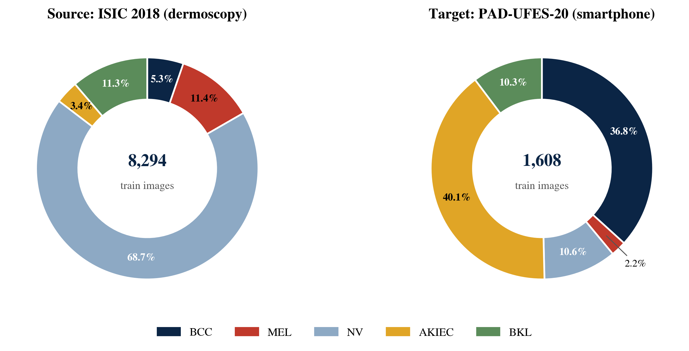
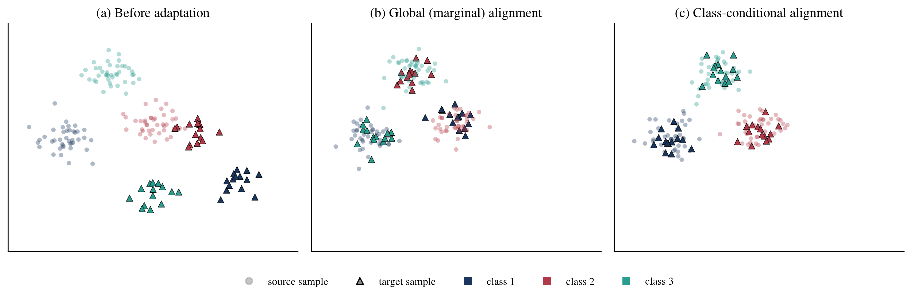
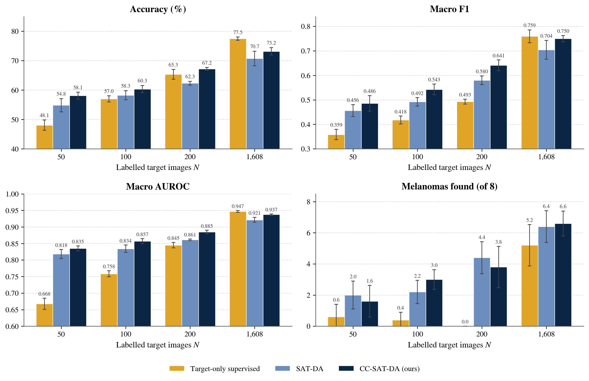
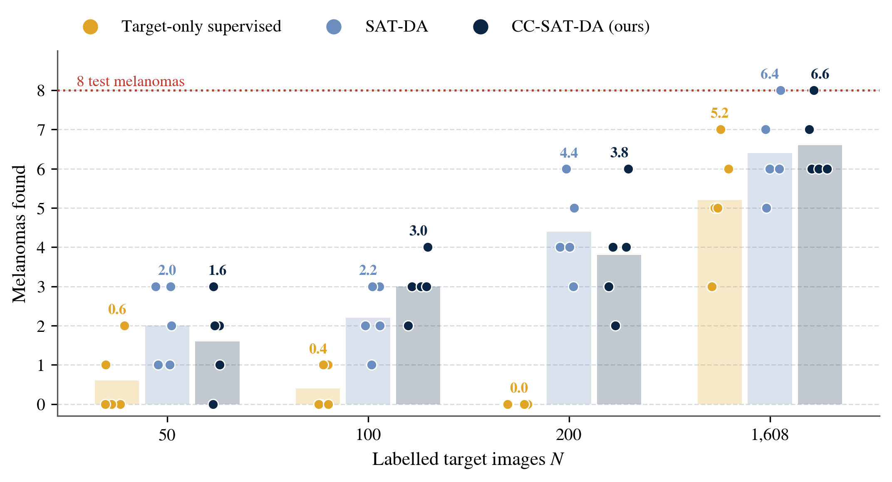
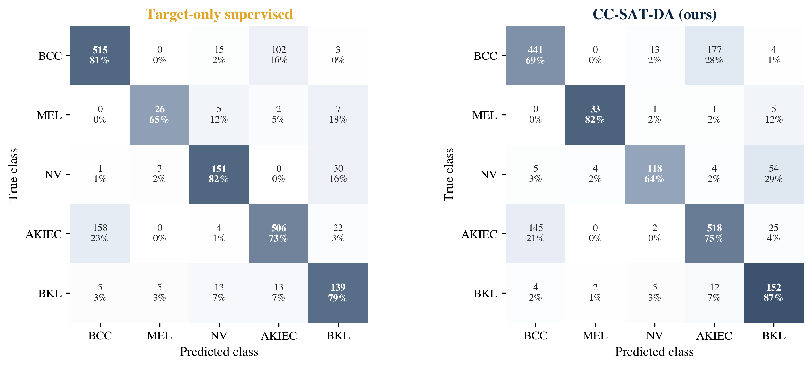

# CC-SAT-DA: Class-Conditional Domain Adaptation for Skin-Lesion Diagnosis

**From dermoscopy to smartphone photos when only a few labelled phone images are available.**

CC-SAT-DA is a supervised domain adaptation method. It transfers a skin-lesion classifier from a large labelled set of dermoscopy images (ISIC 2018) to smartphone photos (PAD-UFES-20) when only 50 to 200 labelled phone photos exist. It extends [SAT-DA](#references) (Selective Alignment Transfer, MICCAI 2025) with two changes:

1. **Class-conditional alignment.** The model matches each disease to the same disease in the other domain, instead of matching the two domains as a whole.
2. **Prior calibration at test time.** Each class's score is adjusted for how common that disease is in the target clinic.

B.Tech Project, Department of Computer Science and Engineering, IIT Indore.
**Authors:** Sameer, Hardik. **Supervisor:** Prof. Nagendra Kumar.

---

## The problem

Three difficulties occur together:

- **Appearance shift.** Contact dermoscopy shows structures under the skin surface. A phone camera sees only the surface, with glare, blur and uneven light.
- **Prior shift.** Nevi make up 68.7% of the source data. BCC and AKIEC together make up 77% of the target data, and melanoma falls from 11.4% to 2.2%.
- **Few target labels.** 50 labelled phone photos contain a single melanoma. Training on the target alone learns to predict only the common classes. We call this the *accuracy illusion*.

<p align="center"></p>

## Method

<p align="center"></p>

| Step | Component | Origin |
|---|---|---|
| 1 | Every training step takes a labelled dermoscopy batch (32 images) and a labelled phone batch (16 images). | SAT-DA |
| 2 | A shared **EfficientNet-B2** encoder (ImageNet weights, 288 px) embeds both batches. | SAT-DA |
| 3 | A **second-order channel selector** reads the per-channel mean and standard deviation of both batches. It outputs one weight per channel, which turns down channels that react to the camera rather than to the lesion. | SAT-DA |
| 4 | **Class-conditional alignment:** on the top 50% of channels, an MSE loss pulls the phone-photo centroid of each class towards the dermoscopy centroid of the same class. | **new** |
| 5 | **Prior calibration** at test time: `logits + τ · log(π_target / π_source)` with τ = 0.35. | **new** |

Training objective:

```
L = 0.5·CE_src + 1.5·CE_tgt + 0.2·L_class-align + 0.01·L_selector
```

- **CE_src and CE_tgt:** cost-sensitive cross-entropy. Class weights are inverse to class frequency; MEL and AKIEC are weighted ×1.5 in the source loss and ×2 in the target loss.
- **L_class-align:** the class-conditional alignment loss from step 4.
- **L_selector:** the SAT-DA selector regulariser.

Training settings are AdamW and a cosine schedule, run for 15 epochs × 60 steps with mixed precision. The epoch is selected on validation accuracy + Macro F1. At inference the model is a plain EfficientNet-B2 with fixed channel weights, so there is no extra cost.

## Results

All results are on the **345 held-out PAD-UFES-20 phone photos (8 melanomas)**. Each value is the mean ± std over **five training seeds** (42, 123, 456, 789, 1011). Raw per-run logits are in [`results/seed_study_345/results/`](results/seed_study_345/results), and the full table, including per-seed rows, is in [`results/seed_study_345/SUMMARY.md`](results/seed_study_345/SUMMARY.md).

| N (labelled phone photos) | Method | Accuracy (%) | Macro F1 | Macro AUROC | Melanomas found (of 8) | MEL precision |
|---|---|---|---|---|---|---|
| 50 | Target-only supervised | 48.1 ± 1.8 | 0.359 ± 0.021 | 0.668 ± 0.017 | 0.6 | 7% |
| | SAT-DA | 54.8 ± 2.2 | 0.456 ± 0.024 | 0.818 ± 0.014 | 2.0 | 14% |
| | **CC-SAT-DA (ours)** | **58.1 ± 1.2** | **0.486 ± 0.032** | **0.835 ± 0.008** | 1.6 | **39%** |
| 100 | Target-only supervised | 57.0 ± 1.0 | 0.418 ± 0.016 | 0.758 ± 0.009 | 0.4 | 12% |
| | SAT-DA | 58.3 ± 1.5 | 0.492 ± 0.017 | 0.834 ± 0.011 | 2.2 | 19% |
| | **CC-SAT-DA (ours)** | **60.3 ± 1.2** | **0.543 ± 0.022** | **0.857 ± 0.008** | **3.0** | **54%** |
| 200 | Target-only supervised | 65.3 ± 1.7 | 0.493 ± 0.010 | 0.845 ± 0.008 | 0.0 | 0% |
| | SAT-DA | 62.3 ± 0.7 | 0.580 ± 0.018 | 0.861 ± 0.003 | 4.4 | 35% |
| | **CC-SAT-DA (ours)** | **67.2 ± 0.5** | **0.641 ± 0.022** | **0.885 ± 0.005** | 3.8 | **64%** |
| 1,608 (full) | Target-only supervised | **77.5 ± 0.5** | **0.759 ± 0.026** | **0.947 ± 0.003** | 5.2 | 76% |
| | SAT-DA | 70.7 ± 2.5 | 0.704 ± 0.038 | 0.921 ± 0.007 | 6.4 | 65% |
| | **CC-SAT-DA (ours)** | 73.2 ± 1.3 | 0.750 ± 0.013 | 0.937 ± 0.002 | **6.6** | **86%** |

<p align="center"></p>

**Key findings**

- **N ≤ 200:** CC-SAT-DA has the best accuracy, Macro F1 and AUROC at every budget. Its Macro F1 beats target-only training in **all 15** low-data runs.
- **N = 200:** CC-SAT-DA gains **+0.148 Macro F1** over target-only training (0.641 vs 0.493). It also finds 3.8 of 8 melanomas, where target-only finds none in any seed.
- **Against SAT-DA:** CC-SAT-DA has higher Macro F1 and AUROC at every N, which supports aligning class by class rather than globally.
- **Full data (1,608 images):** target-only training catches up on accuracy, and Macro F1 is level within the seed spread. CC-SAT-DA still finds more melanomas (6.6 vs 5.2), and more of its melanoma calls are correct (86% vs 76%).

<p align="center">
  
  
</p>

### Extended variant: CC-SAT-DA + memory

`src/train_cc_satda_v2.py` adds EMA prototype memory banks, reliability-weighted alignment and a validation-chosen τ. It was evaluated in a separate five-seed study, `results/extended_v2/`, together with a weight sweep and a memory-component ablation.

That study uses a different split: AKIEC is ACK only, giving a 316-image test set. Compare its numbers only with the matched supervised baseline on the same split, in `results/extended_v2/supervised_matched/`. It is reported as a secondary study in our BTP report.

| N | Accuracy (%) | Macro F1 | Macro AUROC | Melanoma recall |
|---|---|---|---|---|
| 50 | 59.1 ± 1.8 | 0.484 ± 0.015 | 0.817 ± 0.012 | 20.0% |
| 100 | 61.9 ± 4.3 | 0.525 ± 0.050 | 0.862 ± 0.011 | 30.0% |
| 200 | 69.4 ± 1.6 | 0.618 ± 0.017 | 0.892 ± 0.007 | 45.0% |
| 1,474 (full) | 75.3 ± 2.2 | 0.704 ± 0.053 | 0.939 ± 0.008 | 47.5% |

## Repository structure

```
├── src/                                   # Models, data pipeline, training loops
│   ├── run_ultra_low_resource_study.py    # Data splits, EfficientNet encoder, channel selector,
│   │                                      #   target-only supervised and SAT-DA baselines
│   ├── train_class_conditioned_satda.py   # CC-SAT-DA (main method)
│   ├── train_cc_satda_v2.py               # Extended variant: EMA memory + reliability weighting
│   └── run_overnight_cc_satda_benchmark.py# Weight sweep, ablation and multi-seed suite for the variant
├── experiments/
│   ├── seed_study_345/                    # Main five-seed benchmark (table above)
│   │   ├── run_study.py                   #   train one (method, N, seed), save val/test logits
│   │   ├── launcher.py / launcher_rerun.py#   schedule all 60 jobs across GPUs (resumable)
│   │   ├── analyze.py                     #   calibrate and aggregate -> SUMMARY.md, per_seed.json
│   │   └── gen_report_figures.py          #   figures/main/* and the LaTeX table
│   └── extended_v2/supervised_matched.py  # Matched supervised baseline for the extended study
├── results/
│   ├── seed_study_345/                    # 60 runs: logits (JSON), training logs, SUMMARY.md
│   └── extended_v2/                       # Results of the extended study (CSV/JSON/MD)
├── figures/                               # Result figures (regenerated by gen_report_figures.py)
└── data/README.md                         # Dataset download and expected layout (data not included)
```

Datasets, image caches and model checkpoints are not included.

## Getting started

### 1. Install

```bash
git clone https://github.com/samnotfound404/selective-alignment-domain-adaptation.git
cd selective-alignment-domain-adaptation
pip install -r requirements.txt
```

### 2. Get the data

Download ISIC 2018 Task 3 and PAD-UFES-20, and arrange them as described in [`data/README.md`](data/README.md). To keep them somewhere else, set `CCSATDA_DATA=/path/to/data`.

### 3. Reproduce the main benchmark

```bash
# build the resized image caches once
python experiments/seed_study_345/run_study.py --prep

# a single run: method in {sup, satda, cc}, N in {50, 100, 200, full}
python experiments/seed_study_345/run_study.py --method cc --n 200 --seed 42 --device cuda:0

# all 3 methods x 4 N x 5 seeds (skips runs whose result file already exists)
python experiments/seed_study_345/launcher.py

# aggregate (reads the stored logits; no GPU needed) and redraw figures
python experiments/seed_study_345/analyze.py
python experiments/seed_study_345/gen_report_figures.py
```

`analyze.py` and `gen_report_figures.py` run straight from the stored logits in `results/`, so the table and figures can be checked without the datasets.

By default, run outputs go to `results/seed_study_345/`. Set `CCSATDA_STUDY_DIR` to write them somewhere else. One run takes about 12 to 27 minutes on an NVIDIA A16.

### 4. Extended variant

```bash
python src/run_overnight_cc_satda_benchmark.py --device cuda:0          # sweep + ablation + 5 seeds
python experiments/extended_v2/supervised_matched.py --n 200 --out sup_200.json
```

## Evaluation protocol and limitations

- **Calibration:**
  - CC-SAT-DA uses fixed prior calibration with τ = 0.35, as in the report.
  - The baselines are reported uncalibrated.
  - `SUMMARY.md` also reports a "safety" calibration, chosen on validation so that melanoma recall is at least 75%.
- **Backbones:**
  - The target-only baseline uses EfficientNet-B0 at 224 px for N ≤ 200, and B2 at 288 px for the full set.
  - SAT-DA and CC-SAT-DA always use B2 at 288 px.
- **Seeds:** the target subsets are fixed and nested. Seeds change only initialisation and data order.
- **Channel weights:** evaluation uses the channel weights of the selected epoch.
- **Split level:** the split is at image level, not patient level. Some test photos come from patients who are also in the training pool, so a patient-level split is listed as future work.
- **Test-set size:** the test set has only 8 melanomas, so melanoma counts carry high variance.

## References

1. N. Sultana, W. Lu, X. Fan, M. H. Yap. *Selective Alignment Transfer for Domain Adaptation in Skin Lesion Analysis.* MICCAI 2025.
2. N. Codella et al. *Skin Lesion Analysis Toward Melanoma Detection 2018: A Challenge Hosted by the ISIC.* arXiv:1902.03368, 2019.
3. P. Tschandl, C. Rosendahl, H. Kittler. *The HAM10000 dataset.* Scientific Data 5, 2018.
4. A. G. C. Pacheco et al. *PAD-UFES-20: A skin lesion dataset composed of patient data and clinical images collected from smartphones.* Data in Brief 32, 2020.
5. M. Tan, Q. V. Le. *EfficientNet: Rethinking Model Scaling for Convolutional Neural Networks.* ICML 2019.
6. M. Long, Y. Cao, J. Wang, M. I. Jordan. *Learning Transferable Features with Deep Adaptation Networks.* ICML 2015.
7. S. Xie, Z. Zheng, L. Chen, C. Chen. *Learning Semantic Representations for Unsupervised Domain Adaptation.* ICML 2018.
8. Y. Cui et al. *Class-Balanced Loss Based on Effective Number of Samples.* CVPR 2019.
9. M. Saerens, P. Latinne, C. Decaestecker. *Adjusting the Outputs of a Classifier to New a Priori Probabilities.* Neural Computation 14(1), 2002.

## Citation

```bibtex
@misc{ccsatda2026,
  title  = {CC-SAT-DA: Class-Conditional Domain Adaptation for Skin-Lesion Diagnosis},
  author = {Sameer and Hardik},
  year   = {2026},
  note   = {B.Tech Project, Indian Institute of Technology Indore},
  url    = {https://github.com/samnotfound404/selective-alignment-domain-adaptation}
}
```

## License

MIT, see [LICENSE](LICENSE). The datasets keep their own licences (ISIC: CC BY-NC; PAD-UFES-20: CC BY 4.0).
