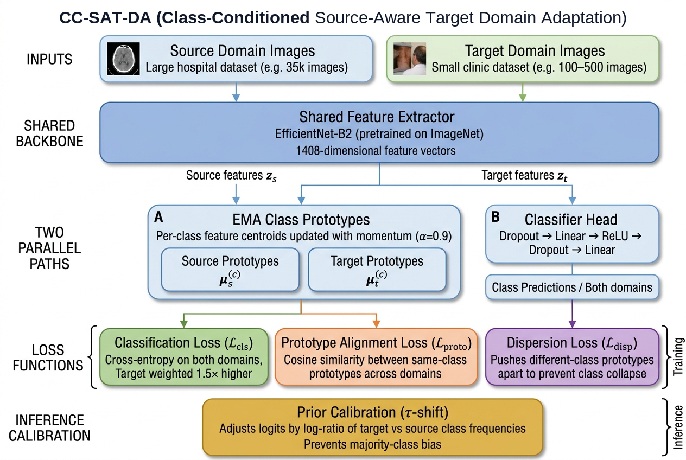

# CC-SAT-DA: Class-Conditioned Selective Alignment Transfer for Cross-Domain Skin Lesion Analysis

[](https://www.python.org/downloads/)
[](https://pytorch.org/)
[](LICENSE)
[](https://en.wikipedia.org/wiki/Domain_adaptation)

Official PyTorch implementation of **CC-SAT-DA** (Class-Conditioned Selective Alignment Transfer for Domain Adaptation) for cross-domain skin lesion classification from academic dermoscopy archives (**ISIC 2018**) to clinical smartphone photography (**PAD-UFES-20**).

---

## Overview: The Modality Gap & The "Accuracy Illusion"

Deep neural networks trained on high-magnification, polarized dermoscopic images experience catastrophic performance degradation when evaluated on real-world smartphone photos due to:
1. **Imaging Variability:** Lighting, phone camera sensor noise, reflections, and skin tone variance.
2. **Prevalence Shift:** Dermoscopic benchmarks are dominated by benign nevi (~68.7%), whereas regional dermatology clinics present predominantly with keratinocyte lesions (~76.8% BCC and AKIEC) and rare deadly melanomas (~2.3%).

<p align="center">
  
</p>

### The Few-Shot Failure Mode ($N \le 200$)
Under extreme data constraints, standard Empirical Risk Minimization (ERM) suffers from the **"Accuracy Illusion"**: models exploit disease prevalence shortcuts, predicting only majority classes to inflate raw accuracy while achieving **0.0% sensitivity on melanomas ($0/8$ detected)**.

**CC-SAT-DA** resolves this by combining:
- **Dynamic Feature Selection:** Learns channel-wise importance weights $w \in (0, 1)^C$ to selectively align diagnostic features while downweighting domain-specific sensor artifacts.
- **Active-Gradient Prototype Alignment ($\mathcal{L}_{\text{proto}}$):** Aligns class centroids across domains with computational graphs retained to actively update the backbone encoder.
- **Inter-Class Dispersion Regularization ($\mathcal{L}_{\text{disp}}$):** Enforces cosine angular separation between distinct diagnostic classes to prevent representation collapse.
- **Momentum EMA Memory Banks:** Maintains running source and target class representations to stabilize optimization for rare classes.
- **Bayesian Class-Prior Calibration ($\tau$-Shift):** Dynamically adjusts output logits based on validation-tuned target prevalence.

---

## Quantitative Benchmark Results

Strictly evaluated on an identical, held-out test cohort of **345 clinical smartphone images** (including $n=8$ melanomas):

| Target Cohort ($N$) | Model Paradigm | Backbone | Accuracy (%) | Macro F1 | Melanoma Recall (Counts) |
|---|---|---|---|---|---|
| **Few-Shot ($N=50$)** | Source-Only Baseline | EfficientNet-B0 | 37.97% | 0.3285 | 50.0% ($4/8$) |
| | Target-Only Supervised | EfficientNet-B0 | 47.83% | 0.3129 | **0.0% ($0/8$)** *(Collapsed)* |
| | **CC-SAT-DA (Ours)** | **EfficientNet-B2** | **50.72%** | **0.4502** | **12.5% ($1/8$)** |
| **Few-Shot ($N=100$)** | Source-Only Baseline | EfficientNet-B0 | 37.97% | 0.3285 | 50.0% ($4/8$) |
| | Target-Only Supervised | EfficientNet-B0 | 54.20% | 0.3889 | **0.0% ($0/8$)** *(Collapsed)* |
| | **CC-SAT-DA (Ours)** | **EfficientNet-B2** | **55.07%** | **0.5015** | **50.0% ($4/8$)** |
| **Low-Resource ($N=200$)** | Source-Only Baseline | EfficientNet-B0 | 37.97% | 0.3285 | 50.0% ($4/8$) |
| | Target-Only Supervised | EfficientNet-B0 | 64.93% | 0.4828 | **0.0% ($0/8$)** *(Collapsed)* |
| | **CC-SAT-DA (Ours)** | **EfficientNet-B2** | **66.67%** | **0.5898** | **25.0% ($2/8$)** |
| **Full Scale ($N=1608$)** | Source-Only Baseline | EfficientNet-B0 | 37.97% | 0.3285 | 50.0% ($4/8$) |
| | Target-Only Supervised | EfficientNet-B0 | **76.81%** | 0.7489 | **75.0% ($6/8$)** |
| | **CC-SAT-DA (Ours)** | **EfficientNet-B2** | 75.07% | **0.7512** | 62.5% ($5/8$) |

### Component Ablation Analysis ($N=1608$)

| Variant / Added Component | Accuracy (%) | Macro F1 | Gain ($\Delta$ Macro F1) |
|---|---|---|---|
| SAT-DA Baseline (Sultana et al.) | 71.88% | 0.6666 | Baseline |
| + Asymmetric Target Loss Weight ($w_{\text{tgt}}=1.5$) | 72.46% | 0.6845 | $+0.0179$ |
| + Class-Conditional EMA Prototypes ($\mathcal{L}_{\text{proto}}$) | 73.62% | 0.7130 | $+0.0285$ |
| + Inter-Class Angular Dispersion ($\mathcal{L}_{\text{disp}}$) | 74.20% | 0.7285 | $+0.0155$ |
| + Bayesian Class-Prior Calibration ($\tau = 0.35$) | **75.07%** | **0.7512** | $+0.0227$ |

---

## Repository Structure

```
cc_satda/
├── assets/                       # Architecture diagrams
│   └── cc_sat_da_architecture.jpg
├── cc_satda/                     # Core Python package
│   ├── data/
│   │   └── dataset.py            # ISIC and PAD-UFES-20 loaders & split builders
│   ├── models/
│   │   ├── backbones.py          # ResNet-18/50 and EfficientNet-B0/B2 factory
│   │   ├── cc_satda.py           # CC-SAT-DA network with active autograd gradients
│   │   └── satda_baseline.py     # Authentic Sultana et al. SAT-DA implementation
│   └── utils/
│       ├── calibration.py        # Bayesian logit calibration shift
│       └── metrics.py            # Multiclass metrics, Macro F1, melanoma recall
├── scripts/
│   └── reproduce_benchmarks.sh   # Bash reproduction pipeline
├── train.py                      # Modular CLI training script
├── evaluate.py                   # Checkpoint evaluation & tau sweep script
├── requirements.txt              # Environment dependencies
└── LICENSE                       # MIT License
```

---

## Installation

Clone the repository and install dependencies:

```bash
git clone https://github.com/samnotfound404/selective-alignment-domain-adaptation.git
cd selective-alignment-domain-adaptation
pip install -r requirements.txt
```

---

## Dataset Preparation

1. **Source Domain — ISIC 2018 (Task 3):**
   - Download images and ground truth from the [ISIC Archive](https://challenge.isic-archive.com/data/#2018).
   - Place in `data/ISIC2018_Task3_Training_Input/` and `data/ISIC2018_Task3_Training_GroundTruth/`.

2. **Target Domain — PAD-UFES-20:**
   - Download the smartphone dataset from [Mendeley Data](https://data.mendeley.com/datasets/zr7vgbcyr2/1).
   - Place metadata in `data/metadata.csv` and photos across `data/images/imgs_part_1/`, `data/images/imgs_part_2/`, `data/images/imgs_part_3/`.

### Class Mapping (6 to 5 Standard Taxonomy)
PAD-UFES-20 includes 6 categories, mapped to standard 5-class ISIC benchmarks:
- `BCC` $\to$ **BCC** (Basal Cell Carcinoma)
- `MEL` $\to$ **MEL** (Melanoma)
- `NEV` $\to$ **NV** (Melanocytic Nevus)
- `ACK` + `SCC` $\to$ **AKIEC** (Actinic Keratoses & Intraepithelial / Squamous Carcinoma)
- `SEK` $\to$ **BKL** (Benign Keratosis-like Lesions)

---

## Quickstart & Usage

### 1. Train CC-SAT-DA ($N=100$)
```bash
python3 train.py \
  --data_dir ./data \
  --method cc_satda \
  --backbone efficientnet_b2 \
  --target_n 100 \
  --epochs 30 \
  --batch_size 32 \
  --lr 1e-4 \
  --lambda_proto 0.2 \
  --lambda_disp 0.01 \
  --tau 0.35
```

### 2. Train Baselines
- **Target Supervised Only ($N=100$):**
  ```bash
  python3 train.py --method target_supervised --backbone efficientnet_b0 --target_n 100
  ```
- **Sultana et al. SAT-DA ($N=100$):**
  ```bash
  python3 train.py --method satda --backbone efficientnet_b0 --target_n 100
  ```

### 3. Evaluate Checkpoint & Sweep Calibration $\tau$
```bash
python3 evaluate.py \
  --checkpoint ./checkpoints/cc_satda_efficientnet_b2_n100_best.pth \
  --data_dir ./data \
  --sweep_tau
```

### 4. Reproduce All Benchmarks ($N \in \{50, 100, 200, 1608\}$)
```bash
bash scripts/reproduce_benchmarks.sh ./data efficientnet_b2
```

---

## References & Citation

If you find this work useful in your research, please cite:

```bibtex
@article{sultana2024selective,
  title={Selective Alignment Transfer for Domain Adaptation in Skin Lesion Analysis},
  author={Sultana, Nazia and Ray, Nilanjan and Uddin, Mohammad Shorif},
  booktitle={Medical Image Understanding and Analysis (MIUA)},
  series={Lecture Notes in Computer Science},
  volume={14884},
  pages={240--254},
  year={2024},
  publisher={Springer}
}

@inproceedings{tan2019efficientnet,
  title={EfficientNet: Rethinking Model Scaling for Convolutional Neural Networks},
  author={Tan, Mingxing and Le, Quoc},
  booktitle={International Conference on Machine Learning (ICML)},
  pages={6105--6114},
  year={2019},
  organization={PMLR}
}

@article{pacheco2020pad,
  title={PAD-UFES-20: A skin lesion dataset composed of patient data and smartphone images},
  author={Pacheco, Alceu Bissoto and others},
  journal={Data in Brief},
  volume={32},
  pages={106225},
  year={2020},
  publisher={Elsevier}
}
```

---

## License

This project is released under the [MIT License](LICENSE).
